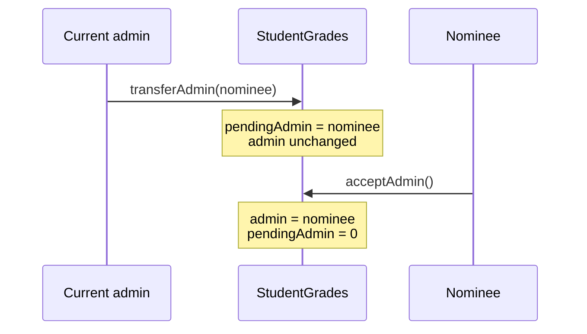

# StudentGrade-contract

[](https://github.com/milah-247/StudentGrade-contract/actions/workflows/test.yml)


A small Solidity smart contract for recording student scores, built and tested with [Foundry](https://book.getfoundry.sh/).

One admin account registers students and sets their scores (0–100). Each student can read their own record. The admin can hand over the role to another account in two steps.

> **Privacy warning.** Everything on a public blockchain is public. That includes contract storage, events and the inputs of every transaction. The read checks in this contract only limit what its own functions return. Anyone can still read the raw data. **Do not put real student names or real grades on a public network.** See [SECURITY.md](SECURITY.md).

> **Status:** experimental and unaudited. Not for production use.

## Tech stack

| Part | Choice |
| --- | --- |
| Language | Solidity `^0.8.24` (compiled with `0.8.28`, pinned in `foundry.toml`) |
| Framework | Foundry (`forge`) |
| Test library | [forge-std](https://github.com/foundry-rs/forge-std) (git submodule in `lib/`) |
| CI | GitHub Actions: format check, build, tests, Slither |

## Contract overview

Source: [`src/StudentGrades.sol`](src/StudentGrades.sol)

| Function | Who can call | What it does |
| --- | --- | --- |
| `addStudent(address, string name, uint256 score)` | admin | Registers a new student. Rejects the zero address, duplicates, empty names, names over 64 bytes and scores over 100. |
| `updateScore(address, uint256 newScore)` | admin | Changes a registered student's score. Rejects unknown students and scores over 100. |
| `getStudent(address)` | admin, or the student themselves | Returns `(name, score)`. |
| `viewMyGrade()` | any registered student | Returns the caller's own `(name, score)`. |
| `transferAdmin(address newAdmin)` | admin | Nominates a new admin. Calling it again replaces the nominee. |
| `acceptAdmin()` | the nominated admin | Completes the handover. |
| `admin()`, `pendingAdmin()`, `MAX_SCORE()`, `MAX_NAME_LENGTH()` | anyone | Public getters. |

Errors are custom errors (for example `NotAdmin()`, `InvalidScore(uint256)` and `StudentNotFound(address)`), defined at the top of the contract.

Events: `StudentAdded(student)`, `ScoreUpdated(student)`, `AdminTransferStarted(currentAdmin, nominee)` and `AdminTransferred(previousAdmin, newAdmin)`. Events leave out names and scores on purpose.

### Admin handover

The admin role moves in two steps, so a mistyped address can't lock the contract:



Until `acceptAdmin` is called, the old admin keeps full rights and the nominee has none.

## Getting started

### Prerequisites

- [Git](https://git-scm.com/)
- Foundry. Install it with `foundryup`, following the [official guide](https://book.getfoundry.sh/getting-started/installation).

### Setup

```shell
git clone --recurse-submodules https://github.com/milah-247/StudentGrade-contract.git
cd StudentGrade-contract

# If you cloned without --recurse-submodules:
git submodule update --init --recursive
```

### Common commands

```shell
forge build              # compile
forge test -vvv          # run all tests
forge test --match-test test_UpdateScore -vvv   # run matching tests
forge fmt                # format code (CI runs `forge fmt --check`)
forge coverage           # coverage report
forge snapshot           # gas snapshot
```

To run the same fuzz settings as CI:

```shell
FOUNDRY_PROFILE=ci forge test
```

### Static analysis (optional)

```shell
python3 -m venv .venv && . .venv/bin/activate
pip install slither-analyzer==0.10.4
slither . --filter-paths "lib/|test/" --fail-medium
```

## Tests

[`test/StudentGrades.t.sol`](test/StudentGrades.t.sol) contains unit and fuzz tests for:

- **Registration:** stored data, events, boundary scores (0 and 100) and name length limits
- **Access control:** non-admins and students can't register or change scores; students can only read their own record
- **Invalid input:** scores above 100, the zero address, and empty or too-long names
- **Missing and duplicate records:** the right custom error, and existing data isn't overwritten
- **Score updates:** only the score changes, and other students are unaffected
- **Admin handover:** two-step flow, replacing the nominee, wrong caller and zero address
- **Privacy:** one test reads raw storage to show that on-chain data is public whatever the access checks say

Every revert test checks the exact custom error.

## Project layout

```
src/StudentGrades.sol        contract
test/StudentGrades.t.sol     Foundry tests (unit + fuzz)
lib/forge-std                test library (submodule)
.github/workflows/test.yml   CI (format, build, test, Slither)
.github/ISSUE_TEMPLATE/      issue templates
CONTRIBUTING.md              how to contribute
SECURITY.md                  security model, privacy limits, reporting
```

## Deployment

There is no deployment script yet (see [Roadmap](#roadmap)). If you deploy manually, use a local test network (`anvil`) or a testnet. Never pass a private key on the command line or commit one. Use `cast wallet import` and `--account` instead.

## Roadmap

Planned work, open for contributors:

- Remove a student, and cancel a pending admin transfer
- Batch registration
- Several graders (a teacher role) instead of a single admin
- Store a hashed commitment instead of plain-text names (privacy)
- A deployment script with keystore-based signing
- Invariant tests, coverage reporting and gas snapshots in CI

Each item will have its own GitHub issue with scope and acceptance criteria.

## Contributing

Contributions are welcome, including through [Drips Wave](https://docs.drips.network/wave/).

1. Pick an open issue and ask to be assigned before you start.
2. Fork the repo, create a branch, and make sure `forge fmt --check`, `forge build` and `forge test` pass.
3. Open a pull request that links the issue (`Closes #N`) and fill in the PR checklist.

Read [CONTRIBUTING.md](CONTRIBUTING.md) for the full guidelines. Report security problems privately as described in [SECURITY.md](SECURITY.md), not in public issues.

## License

The source files carry `SPDX-License-Identifier: MIT`.
